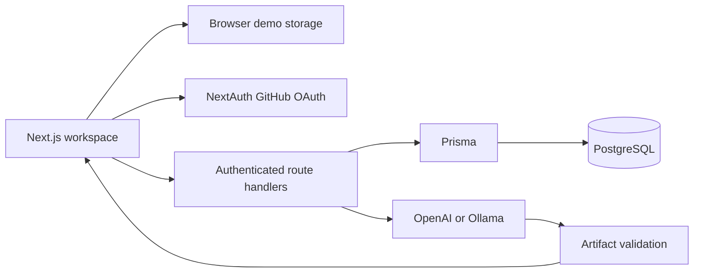

# AI Software Engineer — Next.js rebuild

The new application lives in `web/`. The earlier React/FastAPI implementation remains in the repository during migration, but is not used by this application.

## Run

Use Node 22 or newer. From `web`, run `npm ci` then `npm run dev`. Open http://localhost:3000. No credentials are needed for the browser demo. Every project card opens its own workspace, and each sidebar entry opens a distinct view. Demo projects, runs, tasks, files and conversation history persist in local storage after edits.

## Account mode

Copy `.env.example` to `.env`. Start PostgreSQL with `docker compose -f ../compose.next.yml up -d db`, set `DATABASE_URL`, then run `npm run db:push`. Register a GitHub OAuth application with callback `http://localhost:3000/api/auth/callback/github`. Configure `GITHUB_ID`, `GITHUB_SECRET`, and a random `NEXTAUTH_SECRET`. Restart the app and sign in. Account workspaces are stored through Prisma and scoped to the immutable GitHub provider account ID. Optimistic revision checks prevent silently overwriting a concurrent browser session.

## Generation

Set `OPENAI_API_KEY` and optionally `OPENAI_MODEL` for server-side Responses API generation. Alternatively configure `AI_PROVIDER=ollama`, `OLLAMA_BASE_URL`, and `OLLAMA_MODEL`. Live generation requires authenticated account mode. Server credentials never enter the client bundle. Requests and artifacts are size-limited and schema-validated.

The demo generates explicitly labeled deterministic scaffolds. A live request produces a specification, task list, code files, explanations and a review. Structural checks execute in the application; generated application tests and deployments are **not executed**. The timeline presents artifact processing stages, not separate autonomous workers. Code generation is one bounded provider request. Do not represent this version as a sandboxed autonomous coding agent.

## Deployment

Import the repository into Vercel, set Root Directory to `web`, and use the Next.js framework preset. Add the account/provider environment variables, set `NEXTAUTH_URL` to the deployment URL, and register that OAuth callback. Provision PostgreSQL and apply the schema using `npm run db:push` before enabling account mode. GitHub Pages cannot serve this app's server routes; the old Pages deployment is not the new application.

`compose.next.yml` provides a local Docker setup. Apply the database schema once before starting the web service. The standalone runtime does not run migrations automatically.

## Checks

`npm test` validates domain behavior and unsafe artifact-path rejection. `npm run build` performs production compilation and type checks. `npx playwright install chromium` then `npx playwright test` exercises project navigation, generation, context persistence, task movement and anonymous API denial.

## Architecture

Remaining production work includes a rate-limited durable job queue, isolated code execution, per-run normalized persistence, incremental file diffs, repository synchronization, and actual deployment integrations. No external infrastructure has been provisioned by this source implementation.
